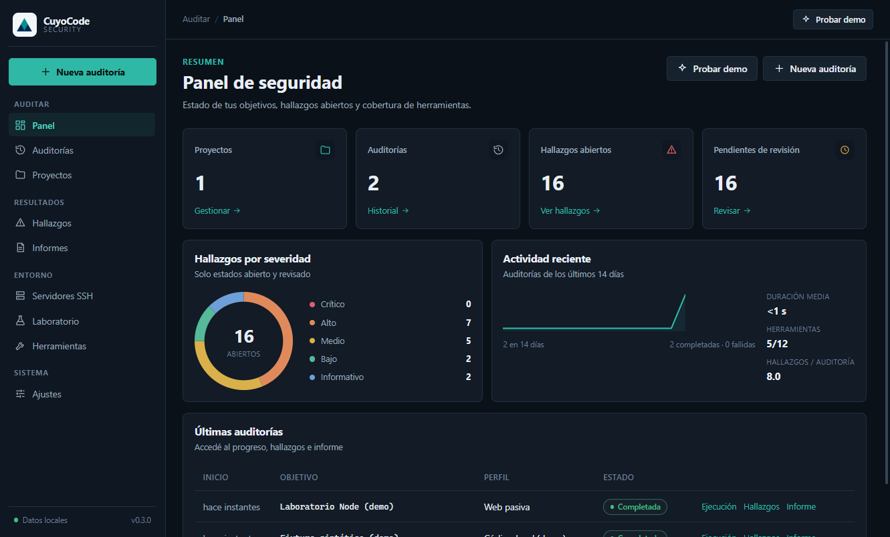
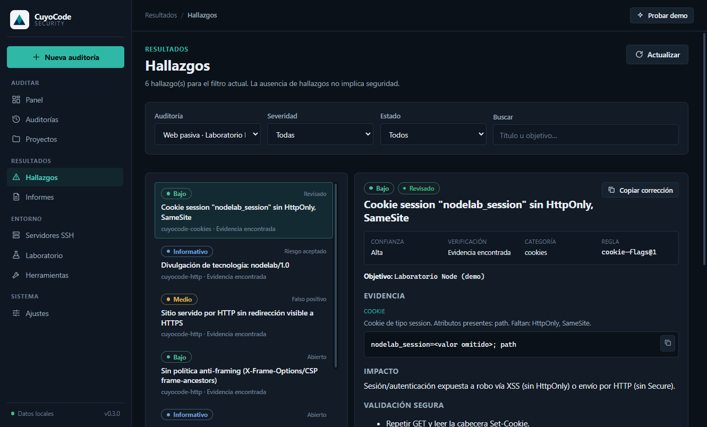
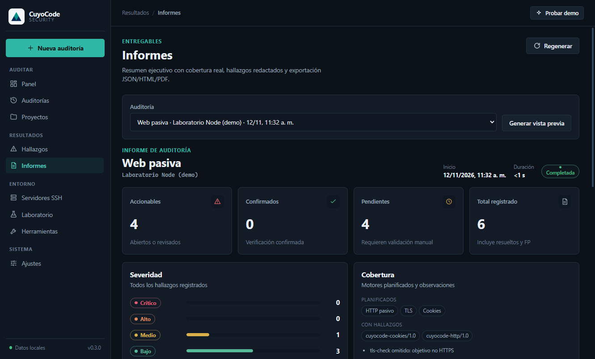
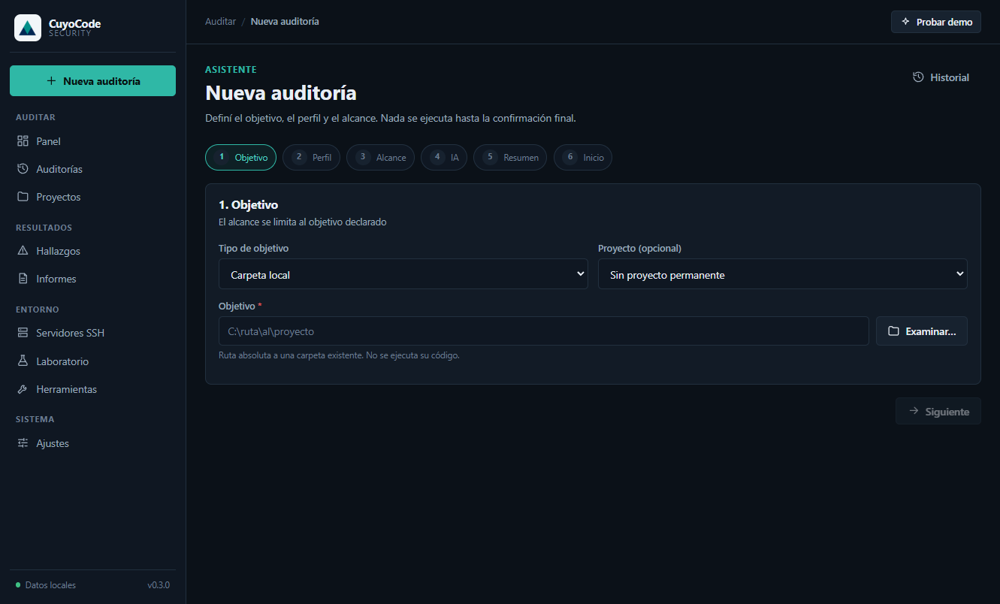
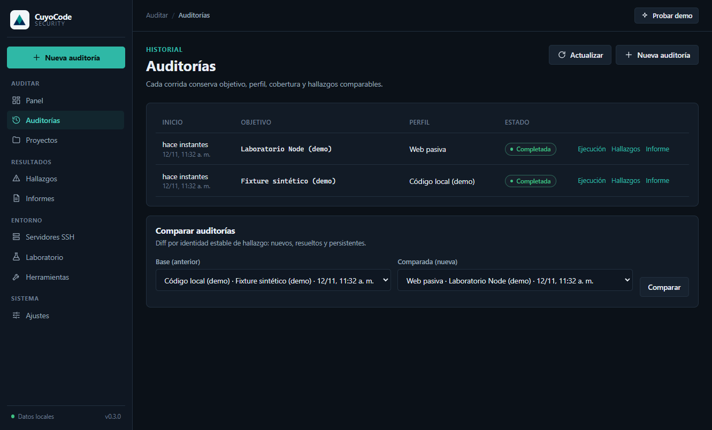
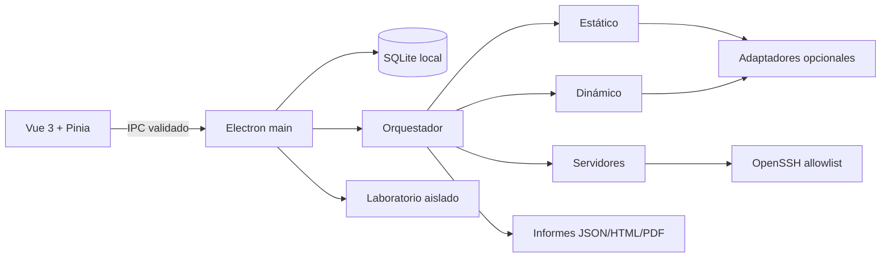

<p align="center">
  
</p>

# CuyoCode Security

**Auditoría de seguridad asistida, local y trazable.** Una app de escritorio que
convierte hallazgos dispersos en evidencia revisable, con cobertura explícita y
sin promesas de "seguridad garantizada".

[](https://github.com/CuyoCode/cuyocode-security/actions/workflows/ci.yml)
[](LICENSE)
[](https://nodejs.org/)
[](https://www.electronjs.org/)



## Por qué existe

Las herramientas de seguridad suelen fallar en los extremos: o son cajas negras
en la nube, o scripts que nadie puede auditar. CuyoCode Security hace lo
contrario:

- **Local por defecto:** los datos y las claves no salen del equipo. Sin telemetría.
- **Determinista:** reglas versionadas y motores propios; la IA es opcional y nunca ejecuta nada.
- **Con cobertura honesta:** cada motor omitido, error o límite queda visible en el informe.
- **Con evidencia:** cada hallazgo incluye ubicación, impacto, validación segura y corrección propuesta.
- **Revisable:** estados de revisión, justificación de falsos positivos e historial de cambios.

> La ausencia de hallazgos **no** significa que un proyecto sea seguro.

## Capturas

| Hallazgos | Informe ejecutivo |
| --- | --- |
|  |  |

| Asistente de auditoría | Historial y comparación |
| --- | --- |
|  |  |

## Capacidades

- **Estática:** reconocimiento de stack, secretos (10 patrones + entropía),
  `npm audit`, 19 reglas propias JS/NestJS/Vue y adaptadores opcionales
  Gitleaks, Semgrep y Trivy.
- **Dinámica:** HTTP/TLS/cookies con guardia de alcance (anti-SSRF/rebinding) y
  adaptadores ZAP/Nuclei.
- **Servidores:** escáner TCP propio, Nmap opcional y SSH de solo lectura
  (13 operaciones versionadas, host key fijada manualmente).
- **Informes:** JSON/HTML/PDF con portada, resumen ejecutivo, top de riesgos,
  cobertura por motor y limitaciones. Secretos redactados en todas las capas.
- **Demo reproducible:** un clic audita un fixture vulnerable sintético y un
  laboratorio Node local. Sin Docker, sin IA y sin herramientas externas.
- **CLI headless:** ejecutable en CI con `--fail-on` por severidad.

## Demo en un clic

```powershell
npm install
npm run dev
```

En la bienvenida elegí **Probar demo segura** (o usá el botón del panel). La app:

1. crea un proyecto de demo;
2. audita `tests/fixtures/vuln-app` con análisis estático;
3. levanta un laboratorio Node vulnerable en `127.0.0.1` y ejecuta análisis web pasivo;
4. deja hallazgos con estados de revisión variados para mostrar el flujo completo.

La demo no requiere Docker ni conexión a internet.

## Quickstart

Requisitos: Windows 10/11, Node.js 24 y npm 11. Git es recomendable.

```powershell
npm install
npm run dev          # Vite + Electron en desarrollo
npm test             # 80 pruebas (unitarias, integración y seguridad)
npm run type-check
npm run build
npm run electron:build   # instalador NSIS en release/
```

Guía completa: [docs/INSTALLATION-WINDOWS.md](docs/INSTALLATION-WINDOWS.md).

## CLI para CI

```powershell
npm run build
node dist-electron/scripts/audit-cli.js `
  --profile local-code `
  --target . `
  --out artifacts/audit `
  --fail-on high
```

Salida: `artifacts/audit.json` + `artifacts/audit.html`. Código de salida `2`
si hay hallazgos accionables en el umbral. No usa Electron, IA ni herramientas
externas obligatorias.

## Perfiles

| Perfil | Objetivo | Motores |
| --- | --- | --- |
| `local-code` | Carpeta | recon, secretos, dependencias, patrones |
| `local-code-deep` | Carpeta | + Gitleaks, Semgrep, Trivy (si están instalados) |
| `web-passive` | URL | HTTP, TLS, cookies |
| `web-active` | URL | + ZAP baseline y Nuclei seleccionado |
| `server-readonly` | Servidor | puertos TCP, Nmap opcional, SSH solo lectura |
| `lab-advanced` | URL/servidor de laboratorio | pruebas profundas con puerta de aislamiento |
| `demo-code` | Carpeta | perfil interno de la demo (sin red) |

## Arquitectura



- `electron/main`: ventana endurecida, IPC, servicios, persistencia y política de seguridad.
- `engine/`: motores deterministas desacoplados de Electron; también los usa la CLI.
- `src/`: renderer Vue 3 con design system propio y estados de carga/error.
- `shared/`: contratos IPC y esquema de hallazgos.
- `rules/`, `profiles/`: reglas y perfiles versionados.

Más detalle: [docs/ARCHITECTURE.md](docs/ARCHITECTURE.md) y
[docs/THREAT-MODEL.md](docs/THREAT-MODEL.md).

## Seguridad y límites

- Renderer con `contextIsolation`, `sandbox` y sin Node; navegación y permisos denegados por defecto.
- Procesos externos con `shell:false`, timeout, tope de salida y allowlists.
- Secretos redactados en logs, evidencias, vistas previas e informes.
- SSH solo lectura con operaciones versionadas y host key fijada manualmente.
- El perfil de laboratorio exige aislamiento verificado; sin verificación se bloquea.
- No hay puntuación global de seguridad ni certificación.

Usá la herramienta **solo sobre objetivos expresamente autorizados**. Ver
[SECURITY.md](SECURITY.md) y [docs/AUTHORIZED-TESTING.md](docs/AUTHORIZED-TESTING.md).

## Pruebas

```powershell
npm test              # 80 pruebas
npm run test:coverage
npm run verify        # type-check + tests + build
```

CI en GitHub Actions ejecuta type-check, tests, build y un escaneo CLI del
fixture vulnerable.

## Documentación

- [Índice de documentación](docs/README.md)
- [Guía de usuario](docs/USER-GUIDE.md)
- [Guion de demo](docs/DEMO.md)
- [Instalación en Windows](docs/INSTALLATION-WINDOWS.md)
- [Modelo de amenazas](docs/THREAT-MODEL.md)
- [Formato de informe](docs/REPORT-FORMAT.md)
- [Privacidad](docs/PRIVACY.md)
- [Roadmap](docs/ROADMAP.md)
- [Contribuir](CONTRIBUTING.md)
- [Código de conducta](CODE_OF_CONDUCT.md)

## Licencia

[MIT](LICENSE). Las herramientas externas opcionales conservan sus propias
licencias (Nmap NPSL, por ejemplo) y no se empaquetan.
