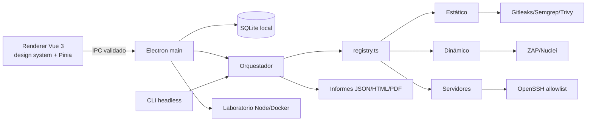

# Arquitectura



```
Renderer (Vue 3 + Pinia + hash-router, sin Node)
  ↕ window.api (firmas fijas, promesas; eventos audits:progress/finished)
Preload (contextBridge; bundle esbuild de un solo archivo por sandbox:true)
  ↕ ipcRenderer.invoke(canal fijo) / .on limitado a progreso
Main (Node 24)
  ├── ipc/register-handlers.ts — validación + sobre {ok}/{error}
  ├── services/audit-service.ts — corridas en 2.º plano, cancelación, IA, demo
  ├── database/ — node:sqlite, user_version 6, backup WAL-safe, audit_findings
  ├── logging/logger.ts — redacción de secretos + rotación 1MB
  └── window.ts / main.ts — ventana endurecida, single instance, fuses
shared/ — contratos IPC + finding-schema (fuente normativa)
engine/ — puro Node, testeable sin Electron y reutilizado por la CLI:
  ├── scope/ (targets, network: resolución + rebinding + IP sensibles)
  ├── process/runner.ts (spawn sin shell, timeout, abort, kill de árbol)
  ├── orchestrator/ (perfiles, registry, gates de lab/consentimiento, validación)
  ├── finding/ (redact, redactCode, dedup por id estable)
  ├── static/ (recon, secrets, deps, patterns) + adapters/
  ├── dynamic/ (fetch-guard, http, tls, cookies) + adapters/
  ├── server/ (ports-tcp, ssh allowlist, linux) + adapters/ (nmap)
  ├── lab/ (Docker etiquetado + Node utilityProcess + verify)
  ├── ai/ (ollama, external https, consent, schema-guard)
  ├── reporting/ (JSON + HTML con resumen ejecutivo)
  └── paths.ts (raíz dev/dist/asar)
rules/ profiles/ skills/ — datos versionados fuera del motor
scripts/audit-cli.ts — CLI headless para CI
```

## Decisiones verificadas

- **Electron 45 + Node 24** empaquetado con `node:sqlite` (sin toolchain nativo).
- **TypeScript estricto** en main/preload/renderer.
- **Preload bundlado** (sandbox no resuelve requires locales).
- **Registro único de motores** (`engine/orchestrator/registry.ts`) usado por la
  app y la CLI.
- **Laboratorio Node con `utilityProcess`**: no depende de `RunAsNode`.
- **Nmap externo opcional** (licencia NPSL, no se empaqueta).
- **Atribución histórica** por `audit_findings`: re-ejecutar no vacía informes previos.
- **Evidencias redactadas** (`redactCode`): los snippets no contienen secretos.
